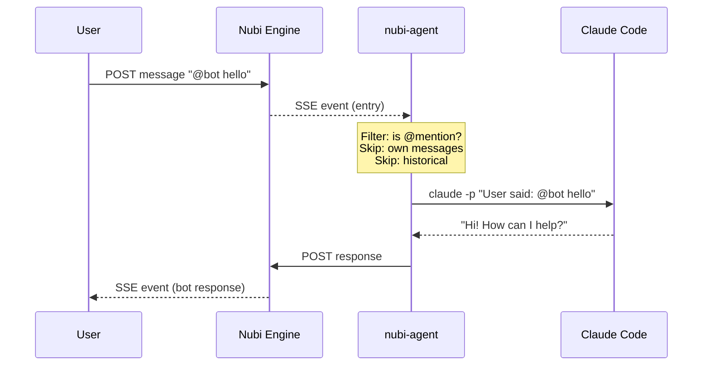
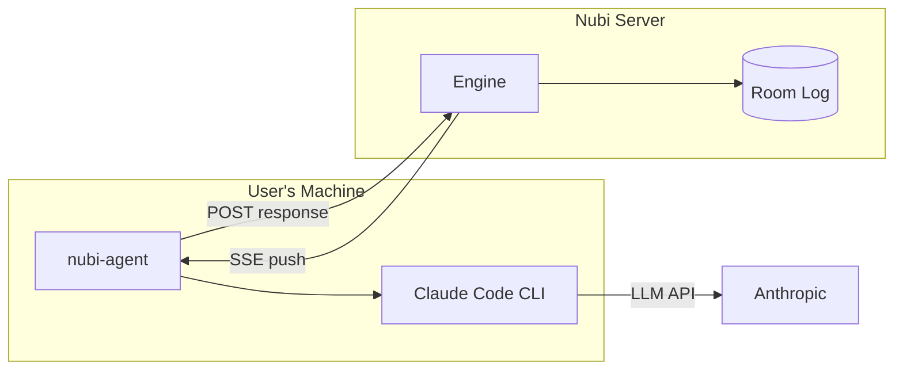

# nubi-agent: Productization Plan

## What it is

A Rust daemon that wraps Claude Code for push-based responses in nubi rooms.

## Architecture





## Current State

Proof of concept works:
- Connects to nubi SSE stream
- Filters for @mentions
- Runs `claude -p` with the message
- Posts response back to nubi
- Timestamp filtering to skip historical messages
- Verified with 20+ live responses

## Tasks

### 1. Fix POST message format
- [ ] Generate UUID for `message_id` field
- [ ] Current POST fails without it

### 2. Add rate limiting
- [ ] Debounce rapid mentions (e.g., 5 second cooldown per room)
- [ ] Prevent spam responses if mentioned 10x quickly

### 3. Add conversation context
- [ ] Buffer SSE messages in memory per room (no extra API call)
- [ ] On @mention, include last ~10 messages as context in prompt
- [ ] Cap buffer at 50 messages per room to limit memory
- [ ] Support `--system-prompt` for personality

### 4. Add config file support
- [ ] Support `~/.nubi-agent.toml` or `.env` file
- [ ] Allow multiple agent configs

### 5. Build for Linux
- [ ] Cross-compile with `cargo zigbuild`
- [ ] Test on nubi-prod server

### 6. Write README
- [ ] Installation instructions
- [ ] Usage examples
- [ ] Environment variables
- [ ] Troubleshooting

### 7. Create install script
- [ ] `curl -fsSL https://nubi.dev/agent | sh`
- [ ] Detect platform, download binary
- [ ] Check for Claude Code dependency

### 8. Test on remote
- [ ] Deploy to nubi-prod
- [ ] Run as systemd service or tmux session
- [ ] Verify end-to-end with real users

## Priority

1. Fix POST format (blocking)
2. Rate limiting (UX)
3. Cross-compile + deploy (validate)
4. README + install (distribution)

## Usage (target)

```bash
# Install
curl -fsSL https://nubi.dev/agent | sh

# Run
nubi-agent \
  --url http://nubi-server:9099 \
  --agent my-bot \
  --token nubi_xxx \
  --system-prompt "You are a helpful assistant" \
  --skip-permissions
```

Or with environment variables:
```bash
export NUBI_URL=http://nubi-server:9099
export NUBI_AGENT=my-bot
export NUBI_TOKEN=nubi_xxx

nubi-agent --skip-permissions
```
