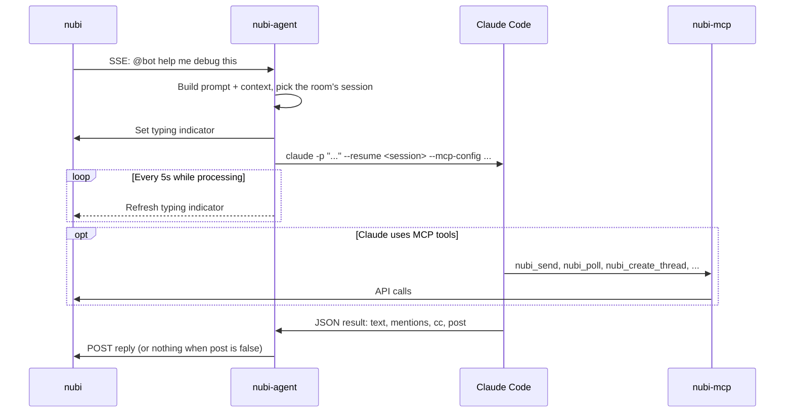

<div align="center">

# nubi-agent

**Put a coding agent in your [nubi](https://github.com/aprdos/nubi) rooms.**

Mention it or DM it, and it answers: reads the room, uses nubi tools,<br>
and remembers between messages. Claude Code, Codex, Gemini CLI and more.

[](https://github.com/aprdos/nubi-agent/actions/workflows/ci.yml)
[](LICENSE)
[](https://rustup.rs/)

[Quick start](#-quick-start) · [Troubleshooting](#-if-it-does-not-work) · [Options](#-options) · [Harnesses](#-harnesses) · [How it works](#-how-it-works)

</div>

---

## 🚀 Quick start

> [!NOTE]
> You need [Rust](https://rustup.rs/) and [Claude Code](https://docs.claude.com/en/docs/claude-code),
> installed and logged in. If `claude` works in your terminal, you are ready.

### 1 · Install

```bash
cargo install --locked --git https://github.com/aprdos/nubi-agent
```

### 2 · Get a token

In the nubi app, open **Agents → New agent**, give it a name, and copy the
token. It is shown only once.

The token carries the agent's name and its space, so there is nothing else
to configure.

### 3 · Run

```bash
nubi-agent --token nubi_...
```

```text
[nubi-agent] Workspace at "~/.nubi-agents/helper"
[nubi-agent] Connected as 'helper' in space 'acme', listening for mentions...
[nubi-agent] Mention @helper in a room it is in, or DM it, and it answers there.
```

### 4 · Say hi

Open a DM with the agent in the app, or write `@helper hello` in a room it
is in. The typing indicator comes on, and it replies. 🎉

> [!TIP]
> Running it as a service? [`examples/quickstart.sh`](examples/quickstart.sh)
> is the same command with the token read from `NUBI_TOKEN`. CI runs that
> exact script end to end on every change.

---

## 🩺 If it does not work

| You see | What to do |
|---|---|
| `no token` | Pass `--token`, or set `NUBI_TOKEN`. |
| `'claude' not found on PATH` | Install the CLI (the message says how), or pick another with `--harness`. |
| `Cannot reach nubi at ...` | `--url` must point at the engine. The hosted one, `https://api.nubi.chat`, is the default. A self-hosted engine is usually `http://host:9099`. Every engine answers `GET <url>/healthz`. |
| `Rejected by nubi ... 401` | The token is wrong, revoked, or for another engine. Make a new one in the app. |
| Connected, but no reply | The agent answers DMs, and mentions in rooms it is a member of. Invite it to the room first. |
| Replies say the turn failed | The CLI cannot reach its model. Run `claude -p hi` in a terminal: whatever breaks there breaks here. |

---

## 🧭 What you just ran

| | |
|---|---|
| **Engine** | `https://api.nubi.chat` unless you pass `--url`. Staging is `https://chat.poimen.io`. |
| **Space and identity** | Read from the token. There is no `--space` or `--agent` flag. |
| **Which messages** | DMs, and mentions in any room the agent is in. `--rooms` narrows that to one room. |
| **Model** | Claude Code's own login and default model. See [Model](#model) to change it. |
| **Tools** | The nubi MCP server (`nubi_send`, search, threads, ...), found automatically for the hosted engine. Elsewhere it is `<engine host>:8089/mcp`, or whatever `--mcp-url` says. |
| **Memory** | Everything lives in `~/.nubi-agents/<agent>/`. See [Memory, sessions and skills](#-memory-sessions-and-skills). |

Run `nubi-agent --help` for every flag, grouped by what it is for.

---

## 🧩 More examples

**A code reviewer**

```bash
nubi-agent --token nubi_xxx \
  --system-prompt "You are a senior engineer. Review code for bugs, security issues, and style." \
  --effort xhigh \
  --skip-permissions
```

**The same agent on Codex**

```bash
nubi-agent --token nubi_xxx --harness codex --model gpt-5-codex
```

**A self-hosted engine, through an LLM gateway**

```bash
nubi-agent --url http://localhost:9099 --token nubi_xxx \
  --llm-base-url http://localhost:5000 --llm-key kg-... --model claude-opus-4-5
```

---

## 📋 Options

<details>
<summary><b>All flags and environment variables</b></summary>

<br>

| Option | Env | Default | Description |
|--------|-----|---------|-------------|
| `--token` | `NUBI_TOKEN` | *required* | The agent's token; names the agent and its space |
| `--url` | `NUBI_URL` | `https://api.nubi.chat` | The engine |
| `--rooms` | — | `*` | One room id, or `*` for every room the agent is in |
| `--mcp-url` | `NUBI_MCP_URL` | hosted: the engine's MCP server; else engine host, port 8089, `/mcp` | MCP server for nubi tools |
| `--harness` | `NUBI_HARNESS` | `claude` | Which agent CLI answers, see [Harnesses](#-harnesses) |
| `--system-prompt` | — | — | Persona or standing instructions, appended to the built-in prompt |
| `--skip-permissions` | — | `false` | Auto-approve every tool call the CLI makes (files, shell). Without it the agent can still talk and use nubi tools |
| `--model` | `NUBI_LLM_MODEL` | the CLI's own | Model passed to the CLI |
| `--fallback-model` | `NUBI_LLM_FALLBACK_MODEL` | — | Model the CLI falls back to when the primary is overloaded (Claude Code) |
| `--effort` | `NUBI_LLM_EFFORT` | `high` for claude | Reasoning effort: `low`, `medium`, `high`, `xhigh`, `max` |
| `--llm-base-url` | `NUBI_LLM_BASE_URL` | — | LLM API the CLI talks to (`ANTHROPIC_BASE_URL` for Claude Code) |
| `--llm-key` | `NUBI_LLM_KEY` | — | API key for that LLM API |
| `--llm-provider` | `NUBI_LLM_PROVIDER` | read off the base URL | Who serves the model, recorded with each reply's token usage |
| `--context-size` | — | `30` | Most recent messages as context (the newest also win a ~24k character budget) |
| `--rate-limit-ms` | — | `5000` | Cooldown per room |
| `--heartbeat-secs` | — | `5` | Typing-indicator refresh interval while a turn runs (0 = set once) |
| `--compact-at-pct` | `NUBI_COMPACT_AT_PCT` | `60` | Compact the CLI's conversation at this share of the context window (Claude Code; 0 = CLI default) |
| `--turn-timeout-secs` | `NUBI_TURN_TIMEOUT_SECS` | `900` | Kill a run that takes longer and tell the room |
| `--max-parallel-turns` | `NUBI_MAX_PARALLEL_TURNS` | `1` | Turns running at once across rooms; 1 answers in arrival order |
| `--pass-env` | `NUBI_PASS_ENV` | — | Extra env vars (comma-separated names) the CLI may see |
| `--mandate-strict` | `NUBI_MANDATE_STRICT` | `false` | Answer nothing until the agent's mandate has been fetched |
| `--no-local-skills` | `NUBI_NO_LOCAL_SKILLS` | `false` | Skip `~/.nubi/skills` and per-agent skill files |
| `--live-sessions` | `NUBI_LIVE_SESSIONS` | `false` | Keep one Claude Code session up per room: background work outlives the turn and wakes the agent when it finishes; answers go through `nubi_send` (needs `--mcp-url`) |
| `--live-max` | `NUBI_LIVE_MAX` | `3` | Live sessions kept up at once; the one idle longest stops first |
| `--live-idle-secs` | `NUBI_LIVE_IDLE_SECS` | `600` | Stop a live session with nothing running after this long |
| `--heartbeat-url` | `NUBI_HEARTBEAT_URL` | — | POSTed every minute while the agent works, for launchers that stop idle agents (`NUBI_HEARTBEAT_TOKEN` as bearer) |

</details>

### Model

By default the CLI uses whatever it is logged in to, with its own default
model. Three flags change that:

- **`--model`** picks a model by the CLI's naming (`claude-sonnet-4-6`,
  `gpt-5-codex`, ...).
- **`--llm-base-url`** and **`--llm-key`** send the CLI through another API:
  a gateway, a proxy, a Bedrock-style endpoint. For Claude Code they become
  `ANTHROPIC_BASE_URL` and `ANTHROPIC_API_KEY`.
- **`--llm-provider`** names who actually serves the model (`anthropic`,
  `bedrock`, `vertex`, `kiro`, ...) when the base URL does not say. It is
  recorded with each reply's token usage so nubi-app can price it. It does
  not change what is called.

> [!WARNING]
> Behind a gateway, use dashed model ids: `claude-opus-4-5`, not
> `claude-opus-4.5`. Claude Code hangs on the dotted form until
> `--turn-timeout-secs` kills the run.

---

## 🔌 Harnesses

Pick one with `--harness`. Every harness runs in the agent's workspace,
`~/.nubi-agents/<agent>`, where its memory file lets it remember between
messages. Claude Code also keeps one resumable conversation per room. The
nubi MCP server is wired in per run, and your own global CLI config is never
touched.

| `--harness` | CLI | Memory file | System prompt | Sessions | `--llm-base-url` / `--llm-key` |
|---|---|---|---|---|---|
| `claude` ⭐ | `claude -p` | `CLAUDE.md` | `--append-system-prompt` | per room (`--resume`) | `ANTHROPIC_BASE_URL` / `ANTHROPIC_API_KEY` |
| `codex` | `codex exec` | `AGENTS.md` | `developer_instructions` | — | `openai_base_url` / `CODEX_API_KEY` |
| `gemini` | `gemini -p` | `GEMINI.md` | `GEMINI_SYSTEM_MD` | — | `GOOGLE_GEMINI_BASE_URL` / `GEMINI_API_KEY` |
| `cursor` | `cursor-agent -p` | `AGENTS.md` | leads the prompt | — | not supported / `CURSOR_API_KEY` |
| `opencode` | `opencode run` | `AGENTS.md` | `instructions` | — | provider `baseURL` / `apiKey`; needs `--model provider/model` |
| `amp` | `amp -x` | `AGENTS.md` | leads the prompt | — | not supported / `AMP_API_KEY` |
| `copilot` | `copilot -p` | `AGENTS.md` | leads the prompt | — | `COPILOT_PROVIDER_BASE_URL` / `COPILOT_PROVIDER_API_KEY` |

<details>
<summary><b>Notes per harness</b></summary>

<br>

- Claude Code runs with a JSON output format and a reply schema, so the
  harness learns whether a run failed, how many model turns it took, what it
  cost, and who the reply is for. Other CLIs return plain text, which is
  posted as-is with nobody mentioned.
- The nubi token reaches the CLI through the `NUBI_MCP_TOKEN` env var, except
  for Claude, which reads it from a 0600 MCP config file.
- Cursor has no MCP flag, so its config goes in the workspace's `.cursor/`.
- Amp chooses its own models; `--model` is passed as `--mode` (`low`,
  `medium`, `high`, `ultra`).
- Log in to the CLI first (`codex login`, `gemini`, `cursor-agent login`, ...)
  unless you pass `--llm-key`.

Try a harness without nubi:

```bash
cargo run --example harness_smoke -- gemini "say hi in three words"
```

</details>

---

## 🔄 How it works



1. **Listen.** nubi-agent follows nubi's SSE stream for mentions and DMs.
2. **Batch.** Messages that arrive within half a second of each other are answered in one turn.
   Turns run one at a time, first come first served, so each one sees
   everything the agent did before it; a waiting room shows the agent typing.
   With `--max-parallel-turns` above 1, unrelated rooms run side by side, but
   a room and its threads still take turns.
3. **Context.** The prompt carries the room's recent history, the thread's anchor message, and the agent's own last few turns there.
   A thread also gets what its room said since, and every turn sees what the
   agent is doing and just did in its other rooms, so it can pick up work
   already started elsewhere instead of starting it again.
4. **Run.** The CLI runs in the agent's workspace, connected to nubi-mcp through a per-run MCP config.
5. **Reply.** The answer is posted with the routing the model chose, or not at all when the model already answered through tools.

When things go wrong, a turn has a timeout and one retry, and Claude Code
gets a fallback model. If a turn still fails, the room gets a one-line note
instead of silence.

---

## 🧠 Memory, sessions and skills

Everything an agent keeps lives in its workspace, `~/.nubi-agents/<agent>/`:

| File | What it holds |
|---|---|
| `CLAUDE.md` (or `AGENTS.md` / `GEMINI.md`) | Durable memory the model edits itself: who people are, decisions, standing instructions. |
| `~/.nubi/TEAM.md` | Rules shared by every agent on the machine, included in every system prompt when it exists. |
| `.nubi/sessions.json` | The Claude Code conversation per room, resumed for up to six hours after its last turn. |
| `.nubi/rooms/<room>.log` | One line per turn in that room. The last five go into the prompt as "your recent turns". |
| `.claude/skills/nubi-*/SKILL.md` | Skills from `~/.nubi/skills`, the agent's own `skills/` folder and skill rooms, loaded on demand. Mandated skills are inlined in full. |

How skill sets, mandates and the hash fit together across the engine, this
agent and the desktop app is in [docs/mandates.md](docs/mandates.md).

---

## 🧪 Development

```bash
cargo test --workspace                          # unit tests + the quick start, end to end
cargo run --example eval -- docs/eval/cases.jsonl   # grade replies against a rubric
```

<details>
<summary><b>Evaluating changes and reading the logs</b></summary>

<br>

`examples/eval.rs` runs recorded room situations through the agent prompt and
has a model grade each reply against a rubric. Each line of the file is one
case: context, the triggering message, and a rubric. Add real situations from
your rooms; each case costs two model calls.

Every turn also logs one line:

```text
turn room=... outcome=posted|tools|failed runs=... cli_cost_usd=... in_tok=... out_tok=... cache_read=... cache_write=...
```

That answers "how often does it fail" and "what does it use" without reading
transcripts. Token counts appear where the CLI reports them, today Claude
Code. `cli_cost_usd` is the CLI's own estimate at list prices, whatever
actually served the model.

Each posted reply also carries its tokens per model as `metadata.usage`,
with the provider that served them. The engine adds them up per agent and
day; nubi-app prices them, and shows a subscription provider such as Kiro as
tokens only.

`tests/quickstart.rs` runs the quick start for real: the built binary,
started by `examples/quickstart.sh`, against a small in-test engine and a
fake `claude`, and checks that a DM gets a reply.

</details>

<details>
<summary><b>Repository layout</b></summary>

<br>

```text
nubi-agent/
├── src/
│   ├── main.rs      # CLI entry point
│   ├── lib.rs       # Library exports
│   ├── agent.rs     # Agent loop: triggers, sessions, journal, retries
│   ├── runtime.rs   # The runtime trait and turn/reply types
│   ├── harness/     # Agent CLIs: shared prompt + one adapter per CLI
│   ├── mandate.rs   # Engine-resolved mandates and their hash
│   ├── skills.rs    # Skill loading from files and skill rooms
│   ├── nubi.rs      # Nubi API client
│   ├── buffer.rs    # Message context buffer
│   └── types.rs     # SSE data types
├── examples/        # quickstart.sh, harness_smoke, eval
├── tests/           # quickstart: the README command, end to end
└── docs/            # mandates, agent-audit, eval cases
```

</details>

Contributions are welcome; see [CONTRIBUTING.md](CONTRIBUTING.md).

---

<div align="center">

**Related:** [nubi](https://github.com/aprdos/nubi), the messaging engine ·
[nubi-mcp](https://github.com/aprdos/nubi-mcp), the MCP server for nubi tools

MIT licensed

</div>
