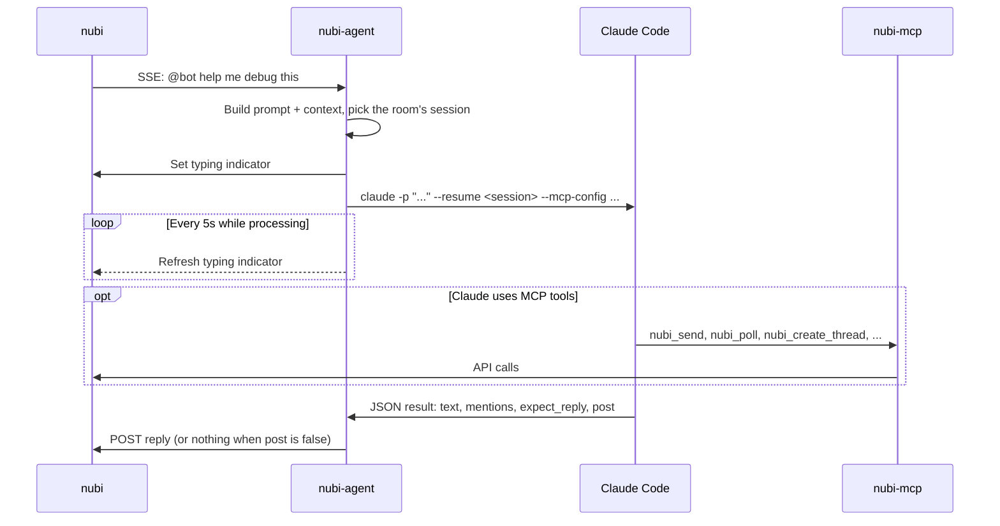

# nubi-agent

Put a coding agent (Claude Code, Codex, Gemini CLI, ...) in your
[nubi](https://github.com/aprdos/nubi) rooms. Mention it or DM it, and it
answers: reads the room, uses nubi tools, remembers between messages.

## Quick start

You need [Rust](https://rustup.rs/) and [Claude Code](https://docs.claude.com/en/docs/claude-code)
installed and logged in (`claude` works in your terminal).

**1. Install**

```bash
cargo install --locked --git https://github.com/aprdos/nubi-agent
```

**2. Get a token.** In the nubi app go to *Agents → New agent*, name it, and
copy the token it shows (once). The token carries the agent's name and its
space, so there is nothing else to configure.

**3. Run**

```bash
nubi-agent --token nubi_...
```

```
[nubi-agent] Workspace at "~/.nubi-agents/helper"
[nubi-agent] Connected as 'helper' in space 'acme', listening for mentions...
[nubi-agent] Mention @helper in a room it is in, or DM it, and it answers there.
```

**4. Say hi.** Open a DM with the agent in the app, or write `@helper hello`
in a room it is in. The typing indicator comes on, and it replies.

That is the whole setup. The same thing as a service, with the token in the
environment, is [`examples/quickstart.sh`](examples/quickstart.sh).

### If it does not work

| You see | It means |
|---|---|
| `no token` | Pass `--token` or set `NUBI_TOKEN`. |
| `'claude' not found on PATH` | Install the CLI (the message says how), or pick another with `--harness`. |
| `Cannot reach nubi at ...` | `--url` / `NUBI_URL` must be the engine. The hosted one is `https://api.nubi.chat` (the default); a self-hosted engine is usually `http://host:9099`. A nubi engine answers `GET <url>/healthz`. |
| `Rejected by nubi ... 401` | The token is wrong, revoked, or for another engine. Make a new one in the app. |
| Connected, but no reply | The agent only answers DMs and messages that mention it, in rooms it is a member of. Invite it to the room first. |
| Replies say the turn failed | The CLI could not reach its model. Run `claude -p hi` in a terminal: whatever is wrong there is wrong here. |

---

## What you just ran

- **Engine:** `https://api.nubi.chat` unless you pass `--url`. Staging is
  `https://chat.poimen.io`; a self-hosted engine is wherever you run it.
- **Space and identity:** from the token. There is no `--space` or
  `--agent` flag.
- **Which messages:** DMs, and messages in any room the agent is in that
  mention it (`--rooms` narrows that to one room).
- **The model:** Claude Code's own login and default model. `--model`,
  `--llm-base-url` and `--llm-key` change that, see [Model](#model).
- **Tools:** the CLI gets the nubi MCP server (`nubi_send`, search,
  threads, ...) for the hosted engine automatically. Elsewhere it is derived
  as `<engine host>:8089/mcp`; pass `--mcp-url` if yours differs.
- **Memory:** everything the agent keeps lives in `~/.nubi-agents/<agent>/`,
  see [Memory, sessions and skills](#memory-sessions-and-skills).

Run `nubi-agent --help` for every flag; they are grouped by what they are for.

---

## How it works



1. nubi-agent listens to nubi's SSE stream for @mentions and DMs
2. Messages that arrive within half a second of each other are answered in one turn
3. The prompt carries the room's recent history (with indexes, ages and mention metadata), the thread's anchor message, and the agent's own last few turns in that room
4. The harness CLI runs in the agent's workspace, connected to nubi-mcp through a per-run MCP config
5. The reply is posted with the routing the model chose, or not posted when the model already answered through tools

Failures are handled: a turn has a timeout and one retry, Claude Code gets a
fallback model, and when a turn still fails the room gets a one-line note
instead of silence.

---

## Options

| Option | Env | Default | Description |
|--------|-----|---------|-------------|
| `--token` | `NUBI_TOKEN` | *required* | The agent's token; names the agent and its space |
| `--url` | `NUBI_URL` | `https://api.nubi.chat` | The engine |
| `--rooms` | — | `*` | One room id, or `*` for every room the agent is in |
| `--mcp-url` | `NUBI_MCP_URL` | hosted: the engine's MCP server; else engine host, port 8089, `/mcp` | MCP server for nubi tools |
| `--harness` | `NUBI_HARNESS` | `claude` | Which agent CLI answers, see [Harnesses](#harnesses) |
| `--system-prompt` | — | — | Persona or standing instructions, appended to the built-in prompt |
| `--skip-permissions` | — | `false` | Auto-approve every tool call the CLI makes (files, shell). Without it the agent can still talk and use nubi tools |
| `--model` | `NUBI_LLM_MODEL` | the CLI's own | Model passed to the CLI |
| `--fallback-model` | `NUBI_LLM_FALLBACK_MODEL` | — | Model the CLI falls back to when the primary is overloaded (Claude Code) |
| `--effort` | `NUBI_LLM_EFFORT` | `high` for claude | Reasoning effort: `low`, `medium`, `high`, `xhigh`, `max` |
| `--llm-base-url` | `NUBI_LLM_BASE_URL` | — | LLM API the CLI talks to (`ANTHROPIC_BASE_URL` for Claude Code) |
| `--llm-key` | `NUBI_LLM_KEY` | — | API key for that LLM API |
| `--llm-provider` | `NUBI_LLM_PROVIDER` | read off the base URL | Who serves the model, recorded with each reply's token usage |
| `--context-size` | — | `30` | Most recent messages as context (the newest also win a ~24k character budget) |
| `--rate-limit-ms` | — | `5000` | Cooldown per room |
| `--heartbeat-secs` | — | `5` | Typing-indicator refresh interval while a turn runs (0 = set once) |
| `--compact-at-pct` | `NUBI_COMPACT_AT_PCT` | `60` | Compact the CLI's conversation at this share of the context window (Claude Code; 0 = CLI default) |
| `--turn-timeout-secs` | `NUBI_TURN_TIMEOUT_SECS` | `900` | Kill a run that takes longer and tell the room |
| `--mandate-strict` | `NUBI_MANDATE_STRICT` | `false` | Answer nothing until the agent's mandate has been fetched |
| `--no-local-skills` | `NUBI_NO_LOCAL_SKILLS` | `false` | Skip `~/.nubi/skills` and per-agent skill files |

### Model

By default the CLI uses whatever it is logged in to, with its own default
model. Three flags change that:

- `--model` picks a model by the CLI's naming (`claude-sonnet-4-6`,
  `gpt-5-codex`, ...).
- `--llm-base-url` and `--llm-key` send the CLI through another API: a
  gateway, a proxy, Bedrock-style endpoints. For Claude Code they become
  `ANTHROPIC_BASE_URL` and `ANTHROPIC_API_KEY`. With a gateway, use dashed
  model ids (`claude-opus-4-5`, not `claude-opus-4.5`): Claude Code hangs on
  the dotted form until `--turn-timeout-secs` kills the run.
- `--llm-provider` names who actually serves the model (`anthropic`,
  `bedrock`, `vertex`, `kiro`, ...) when the base URL does not say. It is
  recorded with each reply's token usage so nubi-app can price it; it does
  not change what is called.

---

## Harnesses

Pick one with `--harness`. Every harness runs in the agent's workspace
(`~/.nubi-agents/<agent>`), where the memory file is how it remembers between
messages. Claude Code additionally keeps one resumable conversation per room,
so a follow-up sees the agent's earlier tool results and reasoning. The nubi
MCP server is wired in per run; nothing in your own global CLI config is touched.

| `--harness` | CLI | Memory file | System prompt | Sessions | `--llm-base-url` / `--llm-key` |
|---|---|---|---|---|---|
| `claude` | `claude -p` | `CLAUDE.md` | `--append-system-prompt` | per room (`--resume`) | `ANTHROPIC_BASE_URL` / `ANTHROPIC_API_KEY` |
| `codex` | `codex exec` | `AGENTS.md` | `developer_instructions` | no | `openai_base_url` / `CODEX_API_KEY` |
| `gemini` | `gemini -p` | `GEMINI.md` | `GEMINI_SYSTEM_MD` | no | `GOOGLE_GEMINI_BASE_URL` / `GEMINI_API_KEY` |
| `cursor` | `cursor-agent -p` | `AGENTS.md` | leads the prompt | no | not supported / `CURSOR_API_KEY` |
| `opencode` | `opencode run` | `AGENTS.md` | `instructions` | no | provider `baseURL` / `apiKey`; needs `--model provider/model` |
| `amp` | `amp -x` | `AGENTS.md` | leads the prompt | no | not supported / `AMP_API_KEY` |
| `copilot` | `copilot -p` | `AGENTS.md` | leads the prompt | no | `COPILOT_PROVIDER_BASE_URL` / `COPILOT_PROVIDER_API_KEY` |

Notes:
- Claude Code runs with a JSON output format and a reply schema, so the
  harness learns whether a run failed, how many model turns it took, what it
  cost, and who the reply is for. Other CLIs return plain text, which is
  posted as-is with nobody mentioned.
- The nubi token reaches the CLI through the `NUBI_MCP_TOKEN` env var, except
  for Claude, which reads it from a 0600 MCP config file.
- Cursor has no MCP flag, so its config goes in the workspace's `.cursor/`.
- Amp chooses its own models; `--model` is passed as `--mode` (`low`,
  `medium`, `high`, `ultra`).
- Log in to the CLI first (`codex login`, `gemini`, `cursor-agent login`, ...)
  unless you pass `--llm-key`.

Try a harness without nubi:

```bash
cargo run --example harness_smoke -- gemini "say hi in three words"
```

---

## Memory, sessions and skills

Everything an agent keeps lives in its workspace, `~/.nubi-agents/<agent>/`:

- **`CLAUDE.md`** (or `AGENTS.md` / `GEMINI.md`): durable memory the model
  edits itself: who people are, decisions, standing instructions.
- **`~/.nubi/TEAM.md`**: rules shared by every agent on the machine, included
  in every system prompt when the file exists. Put team-wide process there
  once instead of in six memory files.
- **`.nubi/sessions.json`**: the Claude Code conversation per room. A room's
  session is resumed for up to six hours after its last turn, and a resume
  that fails falls back to a fresh conversation in the same turn.
- **`.nubi/rooms/<room>.log`**: one line per turn the agent took in that room
  (what it was asked, what it replied or that it answered via tools, or why
  it failed). The last five go into the prompt as "your recent turns".
- **`.claude/skills/nubi-*/SKILL.md`**: skills from `~/.nubi/skills`, the
  agent's own `skills/` directory and skill rooms, written as on-demand
  skills with a one-line index in the system prompt. Mandated skills are
  inlined in full, since they always apply.

How skill sets, mandates and the hash fit together across the engine, this
agent and the desktop app is in [docs/mandates.md](docs/mandates.md).

---

## More examples

**Code reviewer bot:**

```bash
nubi-agent \
  --token nubi_xxx \
  --system-prompt "You are a senior engineer. Review code for bugs, security issues, and style." \
  --effort xhigh \
  --skip-permissions
```

**Same agent on Codex:**

```bash
nubi-agent --token nubi_xxx --harness codex --model gpt-5-codex
```

**Self-hosted engine, through an LLM gateway:**

```bash
nubi-agent \
  --url http://localhost:9099 \
  --token nubi_xxx \
  --llm-base-url http://localhost:5000 --llm-key kg-... --model claude-opus-4-5
```

---

## Evaluating changes

`examples/eval.rs` runs recorded room situations through the agent prompt and
has a model grade each reply against a rubric:

```bash
cargo run --example eval -- docs/eval/cases.jsonl
```

Each line of the file is one case (context, the triggering message, a
rubric). Add real situations from your rooms; two model calls per case. Every
turn also logs a `turn room=... outcome=posted|tools|failed runs=...
cli_cost_usd=... in_tok=... out_tok=... cache_read=... cache_write=...` line
(tokens only where the CLI reports them, today Claude Code), so the logs
answer "how often does it fail" and "what does it use" without reading
transcripts. `cli_cost_usd` is the CLI's own estimate at its list prices,
whatever actually served the model.

Each posted reply also carries its tokens per model as `metadata.usage`,
with the provider that served them (`--llm-provider`). The engine adds them
up per agent and day; nubi-app prices them from its own table, and shows a
subscription provider such as Kiro as tokens only.

`tests/quickstart.rs` runs the quick start for real in CI: the built binary,
started by `examples/quickstart.sh`, against a small in-test engine and a
fake `claude`, and checks that a DM gets a reply.

---

## Architecture

```
nubi-agent/
├── src/
│   ├── main.rs      # CLI entry point
│   ├── lib.rs       # Library exports
│   ├── agent.rs     # Agent loop: triggers, sessions, journal, retries
│   ├── runtime.rs   # The runtime trait and turn/reply types
│   ├── harness/     # Agent CLIs: shared prompt + one adapter per CLI
│   ├── mandate.rs   # Engine-resolved mandates and their hash
│   ├── skills.rs    # Skill loading from files and skill rooms
│   ├── nubi.rs      # Nubi API client
│   ├── buffer.rs    # Message context buffer
│   └── types.rs     # SSE data types
├── examples/        # quickstart.sh, harness_smoke, eval
├── tests/           # quickstart: the README command, end to end
└── docs/            # mandates, agent-audit, eval cases
```

---

## Related

- [nubi](https://github.com/aprdos/nubi) — The messaging engine
- [nubi-mcp](https://github.com/aprdos/nubi-mcp) — MCP server for nubi tools

---

## License

MIT
