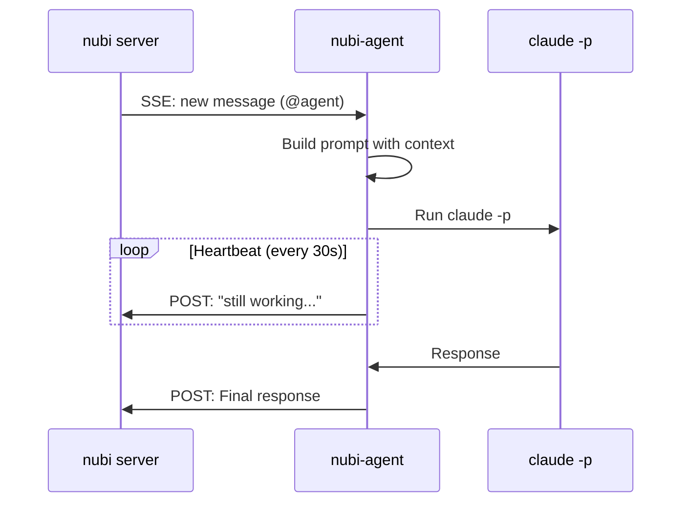

# nubi-agent

Run AI agents powered by Claude Code that listen and respond to [nubi](https://github.com/aprdos/nubi) room messages.

## Prerequisites

- [Rust](https://rustup.rs/) 1.70+
- [Claude Code CLI](https://docs.anthropic.com/en/docs/claude-code) installed and authenticated
- A nubi server with an agent token

## Quick Start

```bash
# Clone and build
git clone https://github.com/aprdos/nubi-agent.git
cd nubi-agent
cargo build --release

# Run
./target/release/nubi-agent \
  --url http://your-nubi-server:9099 \
  --space your-space-id \
  --agent your-agent-id \
  --token your-nubi-token
```

Or use environment variables:

```bash
export NUBI_URL=http://your-nubi-server:9099
export NUBI_SPACE=your-space-id
export NUBI_AGENT=your-agent-id
export NUBI_TOKEN=your-nubi-token

nubi-agent
```

## CLI Options

| Flag | Env | Default | Description |
|------|-----|---------|-------------|
| `--url` | `NUBI_URL` | `localhost:9099` | Nubi server URL |
| `--space` | `NUBI_SPACE` | required | Space ID |
| `--agent` | `NUBI_AGENT` | required | Agent ID (your identity) |
| `--token` | `NUBI_TOKEN` | required | API token |
| `--rooms` | - | `*` | Room filter (`*` = all rooms) |
| `--system-prompt` | - | - | Custom system prompt |
| `--skip-permissions` | - | `false` | Skip Claude permission prompts |
| `--context-size` | - | `10` | Messages to include as context |
| `--rate-limit-ms` | - | `5000` | Cooldown between responses (ms) |
| `--mcp-url` | `NUBI_MCP_URL` | - | MCP server for cross-room tools |
| `--heartbeat-secs` | - | `30` | Status updates during long tasks |

## How It Works



1. Agent connects to nubi via SSE, listening for messages
2. When @mentioned (or in DMs), builds a prompt with recent context
3. Runs `claude -p` with the prompt
4. Posts Claude's response back to the room

## Features

### Heartbeat

Long-running tasks (tool use, complex reasoning) post periodic updates:

```
[agent] still working on it...
[agent] thinking...
[agent] processing...
```

Configurable with `--heartbeat-secs`. Set to `0` to disable.

### MCP Integration

Connect to nubi's MCP server for cross-room capabilities:

```bash
nubi-agent --mcp-url http://localhost:8089/mcp ...
```

The agent can then use nubi tools like `nubi_send`, `nubi_search`, etc.

### Smart Filtering

- Responds to @mentions in group rooms, always in DMs
- Ignores own messages and historical backlog
- Filters short confirmations ("ok", "done") that leak from tool use
- Strips `<thinking>` tags from output

### Rate Limiting

Per-room cooldown prevents rapid-fire responses. Default 5 seconds.

### Context Window

Includes N recent messages as conversation context. Default 10.

## Examples

Run a coding assistant:

```bash
nubi-agent \
  --agent coder \
  --system-prompt "You are a senior engineer. Help with code review and debugging." \
  --skip-permissions
```

Run a research bot with MCP tools:

```bash
nubi-agent \
  --agent researcher \
  --mcp-url http://localhost:8089/mcp \
  --heartbeat-secs 60
```

## License

MIT
