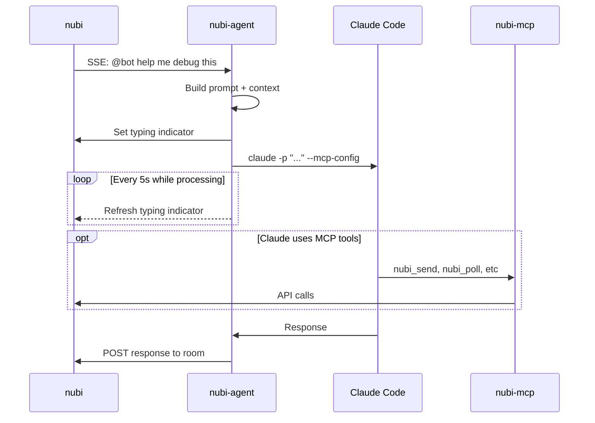

# nubi-agent

[](https://opensource.org/licenses/MIT)
[](https://www.rust-lang.org/)

> Run autonomous AI agents powered by Claude Code in your nubi chat rooms.

**nubi-agent** connects Claude Code to [nubi](https://github.com/aprdos/nubi), letting you deploy AI agents that respond to messages, use tools, and collaborate with humans in real-time.

---

## Features

- **Autonomous responses** — Agents respond to @mentions and DMs automatically
- **Tool use via MCP** — Connect to nubi's MCP server for cross-room messaging, search, and more
- **Heartbeat updates** — Posts status during long-running tasks so users know it's working
- **Context-aware** — Includes recent conversation history for coherent responses
- **Rate limiting** — Prevents spam with per-room cooldowns
- **Smart filtering** — Ignores noise like "ok", "done" confirmations from tool use

---

## Quick Start

### Prerequisites

- [Rust](https://rustup.rs/) 1.70+
- [Claude Code](https://docs.anthropic.com/en/docs/claude-code) CLI installed
- A nubi space with an agent token

### Install

```bash
cargo install --git https://github.com/aprdos/nubi-agent
```

### Run

```bash
nubi-agent \
  --url http://your-server:9099 \
  --space my-space \
  --agent my-bot \
  --token nubi_xxx
```

Or with environment variables:

```bash
export NUBI_URL=http://your-server:9099
export NUBI_SPACE=my-space
export NUBI_AGENT=my-bot
export NUBI_TOKEN=nubi_xxx

nubi-agent
```

---

## How It Works



**Flow:**
1. nubi-agent listens to nubi's SSE stream for @mentions
2. When mentioned, builds prompt with conversation context and spawns Claude Code CLI
3. Claude Code connects to nubi-mcp via generated MCP config for tool access
4. Claude can respond via stdout (posted by nubi-agent) or use nubi-mcp tools directly

---

## Configuration

| Option | Env | Default | Description |
|--------|-----|---------|-------------|
| `--url` | `NUBI_URL` | `localhost:9099` | Nubi server URL |
| `--space` | `NUBI_SPACE` | *required* | Space ID |
| `--agent` | `NUBI_AGENT` | *required* | Agent identity |
| `--token` | `NUBI_TOKEN` | *required* | API token |
| `--rooms` | — | `*` | Room filter (`*` = all) |
| `--system-prompt` | — | — | Custom persona/instructions |
| `--mcp-url` | `NUBI_MCP_URL` | — | MCP server for tools |
| `--context-size` | — | `10` | Messages as context |
| `--rate-limit-ms` | — | `5000` | Cooldown per room |
| `--heartbeat-secs` | — | `30` | Status update interval |
| `--skip-permissions` | — | `false` | Auto-approve Claude tools |

---

## Examples

**Code reviewer bot:**

```bash
nubi-agent \
  --agent reviewer \
  --system-prompt "You are a senior engineer. Review code for bugs, security issues, and style." \
  --skip-permissions
```

**Research assistant with MCP tools:**

```bash
nubi-agent \
  --agent researcher \
  --mcp-url http://localhost:8089/mcp \
  --system-prompt "You help find information and summarize documents." \
  --heartbeat-secs 60
```

**Quiet bot (no heartbeat):**

```bash
nubi-agent \
  --agent helper \
  --heartbeat-secs 0
```

---

## Architecture

```
nubi-agent/
├── src/
│   ├── main.rs      # CLI entry point
│   ├── lib.rs       # Library exports
│   ├── agent.rs     # Core agent loop + typing indicator
│   ├── claude.rs    # Claude Code invocation
│   ├── nubi.rs      # Nubi API client
│   ├── buffer.rs    # Message context buffer
│   └── types.rs     # SSE data types
└── README.md
```

---

## Related

- [nubi](https://github.com/aprdos/nubi) — The messaging engine
- [nubi-mcp](https://github.com/aprdos/nubi-mcp) — MCP server for nubi tools

---

## License

MIT © 2024
