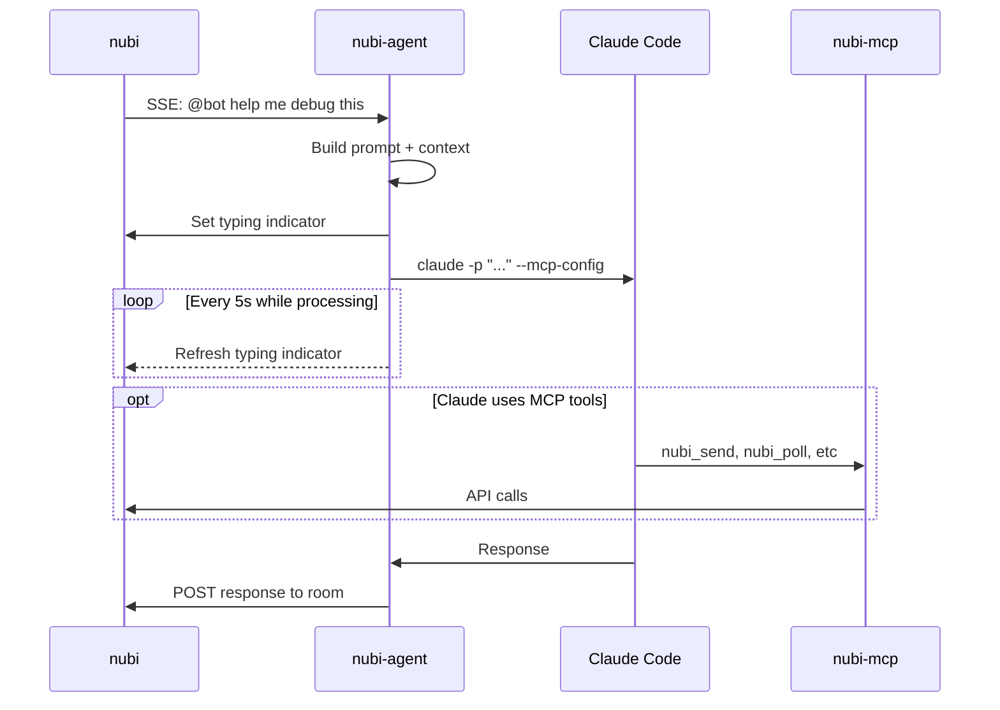

# nubi-agent

[](https://opensource.org/licenses/MIT)
[](https://www.rust-lang.org/)

> Run autonomous AI agents powered by Claude Code, Codex, Gemini CLI and friends in your nubi chat rooms.

**nubi-agent** connects coding-agent CLIs to [nubi](https://github.com/aprdos/nubi), letting you deploy AI agents that respond to messages, use tools, and collaborate with humans in real-time.

---

## Features

- **Autonomous responses** — Agents respond to @mentions and DMs automatically
- **Tool use via MCP** — Connect to nubi's MCP server for cross-room messaging, search, and more
- **Heartbeat updates** — Posts status during long-running tasks so users know it's working
- **Context-aware** — Includes recent conversation history for coherent responses
- **Rate limiting** — Prevents spam with per-room cooldowns
- **Smart filtering** — Ignores noise like "ok", "done" confirmations from tool use

---

## Quick Start

### Prerequisites

- [Rust](https://rustup.rs/) 1.70+
- One supported agent CLI installed (see [Harnesses](#harnesses)); Claude Code is the default
- A nubi space with an agent token

### Install

```bash
cargo install --git https://github.com/aprdos/nubi-agent
```

### Run

```bash
nubi-agent \
  --url http://your-server:9099 \
  --agent my-bot \
  --token nubi_xxx
```

Or with environment variables:

```bash
export NUBI_URL=http://your-server:9099
export NUBI_AGENT=my-bot
export NUBI_TOKEN=nubi_xxx

nubi-agent
```

---

## How It Works



**Flow:**
1. nubi-agent listens to nubi's SSE stream for @mentions
2. When mentioned, builds prompt with conversation context and spawns the harness CLI
3. The harness connects to nubi-mcp through a per-run MCP config for tool access
4. The agent can respond via stdout (posted by nubi-agent) or use nubi-mcp tools directly

---

## Configuration

| Option | Env | Default | Description |
|--------|-----|---------|-------------|
| `--url` | `NUBI_URL` | `localhost:9099` | Nubi server URL |
| `--agent` | `NUBI_AGENT` | *required* | Agent identity |
| `--token` | `NUBI_TOKEN` | *required* | API token |
| `--rooms` | — | `*` | Room filter (`*` = all) |
| `--system-prompt` | — | — | Custom persona/instructions |
| `--mcp-url` | `NUBI_MCP_URL` | — | MCP server for tools |
| `--context-size` | — | `10` | Messages as context |
| `--rate-limit-ms` | — | `5000` | Cooldown per room |
| `--heartbeat-secs` | — | `30` | Status update interval |
| `--harness` | `NUBI_HARNESS` | `claude` | Which agent CLI to run, see below |
| `--skip-permissions` | — | `false` | Auto-approve every tool call |
| `--model` | `NUBI_LLM_MODEL` | `claude-opus-4.5` for claude, else the CLI's own | Model passed to the CLI |
| `--llm-base-url` | `NUBI_LLM_BASE_URL` | `http://localhost:5000` for claude, else unset | LLM backend override |
| `--llm-key` | `NUBI_LLM_KEY` | — | API key for that backend |

---

## Harnesses

Pick one with `--harness`. Each message is a fresh one-shot run in the
agent's workspace (`~/.nubi-agents/<agent>`), and the memory file there is
how it remembers between messages. The nubi MCP server is wired in per run;
nothing in your own global CLI config is touched.

| `--harness` | CLI | Memory file | System prompt | `--llm-base-url` / `--llm-key` |
|---|---|---|---|---|
| `claude` | `claude -p` | `CLAUDE.md` | `--system-prompt` | `ANTHROPIC_BASE_URL` / `ANTHROPIC_API_KEY` |
| `codex` | `codex exec` | `AGENTS.md` | `developer_instructions` | `openai_base_url` / `CODEX_API_KEY` |
| `gemini` | `gemini -p` | `GEMINI.md` | `GEMINI_SYSTEM_MD` | `GOOGLE_GEMINI_BASE_URL` / `GEMINI_API_KEY` |
| `cursor` | `cursor-agent -p` | `AGENTS.md` | leads the prompt | not supported / `CURSOR_API_KEY` |
| `opencode` | `opencode run` | `AGENTS.md` | `instructions` | provider `baseURL` / `apiKey`; needs `--model provider/model` |
| `amp` | `amp -x` | `AGENTS.md` | leads the prompt | not supported / `AMP_API_KEY` |
| `copilot` | `copilot -p` | `AGENTS.md` | leads the prompt | `COPILOT_PROVIDER_BASE_URL` / `COPILOT_PROVIDER_API_KEY` |

Notes:
- The nubi token reaches the CLI through the `NUBI_MCP_TOKEN` env var, except
  for Claude, which reads it from a 0600 temp file as before.
- Cursor has no MCP flag, so its config goes in the workspace's `.cursor/`.
- Amp chooses its own models; `--model` is passed as `--mode` (`low`,
  `medium`, `high`, `ultra`).
- Log in to the CLI first (`codex login`, `gemini`, `cursor-agent login`, ...)
  unless you pass `--llm-key`.

Try a harness without nubi:

```bash
cargo run --example harness_smoke -- gemini "say hi in three words"
```

---

## Examples

**Code reviewer bot:**

```bash
nubi-agent \
  --agent reviewer \
  --system-prompt "You are a senior engineer. Review code for bugs, security issues, and style." \
  --skip-permissions
```

**Research assistant with MCP tools:**

```bash
nubi-agent \
  --agent researcher \
  --mcp-url http://localhost:8089/mcp \
  --system-prompt "You help find information and summarize documents." \
  --heartbeat-secs 60
```

**Same agent on Codex:**

```bash
nubi-agent --agent reviewer --harness codex --model gpt-5-codex
```

**Quiet bot (no heartbeat):**

```bash
nubi-agent \
  --agent helper \
  --heartbeat-secs 0
```

---

## Architecture

```
nubi-agent/
├── src/
│   ├── main.rs      # CLI entry point
│   ├── lib.rs       # Library exports
│   ├── agent.rs     # Core agent loop + typing indicator
│   ├── harness/     # Agent CLIs: shared runtime + one adapter per CLI
│   ├── nubi.rs      # Nubi API client
│   ├── buffer.rs    # Message context buffer
│   └── types.rs     # SSE data types
└── README.md
```

---

## Related

- [nubi](https://github.com/aprdos/nubi) — The messaging engine
- [nubi-mcp](https://github.com/aprdos/nubi-mcp) — MCP server for nubi tools

---

## License

MIT © 2024
