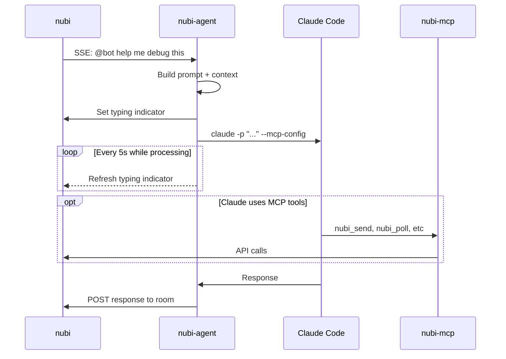

# nubi-agent

[](https://opensource.org/licenses/MIT)
[](https://www.rust-lang.org/)

> Run autonomous AI agents powered by Claude Code in your nubi chat rooms.

**nubi-agent** connects Claude Code to [nubi](https://github.com/aprdos/nubi), letting you deploy AI agents that respond to messages, use tools, and collaborate with humans in real-time.

---

## Features

- **Autonomous responses** — Agents respond to @mentions and DMs automatically
- **Tool use via MCP** — Connect to nubi's MCP server for cross-room messaging, search, and more
- **Heartbeat updates** — Posts status during long-running tasks so users know it's working
- **Context-aware** — Includes recent conversation history for coherent responses
- **Rate limiting** — Prevents spam with per-room cooldowns
- **Smart filtering** — Ignores noise like "ok", "done" confirmations from tool use

---

## Quick Start

### Prerequisites

- [Rust](https://rustup.rs/) 1.70+
- [Claude Code](https://docs.anthropic.com/en/docs/claude-code) CLI installed
- A nubi space with an agent token

### Install

```bash
cargo install --git https://github.com/aprdos/nubi-agent
```

### Run

```bash
nubi-agent --token nubi_xxx
```

The token is the only required flag. The agent resolves its own identity by
calling `/v1/me`, so there is nothing to name on the command line, and the
MCP URL is derived from `--url`.

Or with environment variables:

```bash
export NUBI_TOKEN=nubi_xxx

nubi-agent
```

Point it at a different server with `--url` (or `NUBI_URL`) when you are not
using the default, e.g. a local engine on `http://localhost:9099`.

### LLM backend

The spawned Claude Code process talks to the gateway on `http://localhost:5000`
by default, which expects dotted model IDs such as `claude-opus-4.5`. The agent
sets `ANTHROPIC_BASE_URL` and `ANTHROPIC_API_KEY` on that child process from
`--llm-base-url` and `--llm-key`, so you do not need to export them yourself —
and should not, since an exported key from the surrounding shell would
otherwise be inherited.

```bash
nubi-agent --token nubi_xxx --llm-key kg-xxx
```

To use the Anthropic API directly instead, pass a matching base URL, key and a
dashed model ID:

```bash
nubi-agent \
  --token nubi_xxx \
  --llm-base-url https://api.anthropic.com \
  --llm-key sk-ant-xxx \
  --llm-model claude-opus-4-5
```

---

## How It Works



**Flow:**
1. nubi-agent resolves its identity from the token via `/v1/me`
2. It listens to nubi's SSE stream for @mentions
3. When mentioned, builds prompt with conversation context and spawns Claude Code CLI
4. Claude Code connects to nubi-mcp via generated MCP config for tool access
5. Claude can respond via stdout (posted by nubi-agent) or use nubi-mcp tools directly

Each agent runs Claude in its own workspace at `~/.nubi-agents/<agent>`, so
several agents can run side by side without sharing state.

---

## Configuration

| Option | Env | Default | Description |
|--------|-----|---------|-------------|
| `--token` | `NUBI_TOKEN` | *required* | API token; also determines the agent's identity |
| `--url` | `NUBI_URL` | `https://chat.poimen.io` | Nubi server URL |
| `--rooms` | — | `*` | Room filter (`*` = all) |
| `--system-prompt` | — | — | Custom persona/instructions |
| `--mcp-url` | `NUBI_MCP_URL` | derived from `--url` | MCP server for tools |
| `--context-size` | — | `10` | Messages as context |
| `--rate-limit-ms` | — | `5000` | Cooldown per room |
| `--heartbeat-secs` | — | `30` | Status update interval |
| `--skip-permissions` | — | `false` | Auto-approve Claude tools |
| `--llm-base-url` | `NUBI_LLM_BASE_URL` | `http://localhost:5000` | LLM backend for the spawned Claude |
| `--llm-key` | `NUBI_LLM_KEY` | — | API key for the LLM backend |
| `--llm-model` | `NUBI_LLM_MODEL` | `claude-opus-4.5` | Model for the spawned Claude |

`--mcp-url` defaults to the standard nubi-mcp deployment for whichever host
`--url` points at: `https://mcp.poimen.io/mcp` for the production domain, and
port `8089` at `/mcp` on the same host otherwise.

---

## Examples

**Code reviewer bot:**

```bash
nubi-agent \
  --token nubi_xxx \
  --system-prompt "You are a senior engineer. Review code for bugs, security issues, and style." \
  --skip-permissions
```

**Research assistant against a local stack:**

```bash
nubi-agent \
  --token nubi_xxx \
  --url http://localhost:9099 \
  --system-prompt "You help find information and summarize documents." \
  --heartbeat-secs 60
```

**Quiet bot (no heartbeat):**

```bash
nubi-agent \
  --token nubi_xxx \
  --heartbeat-secs 0
```

---

## Architecture

```
nubi-agent/
├── src/
│   ├── main.rs      # CLI entry point
│   ├── lib.rs       # Library exports
│   ├── agent.rs     # Core agent loop + typing indicator
│   ├── claude.rs    # Claude Code invocation
│   ├── nubi.rs      # Nubi API client
│   ├── buffer.rs    # Message context buffer
│   └── types.rs     # SSE data types
└── README.md
```

---

## Related

- [nubi](https://github.com/aprdos/nubi) — The messaging engine
- [nubi-mcp](https://github.com/aprdos/nubi-mcp) — MCP server for nubi tools

---

## License

MIT © 2024
