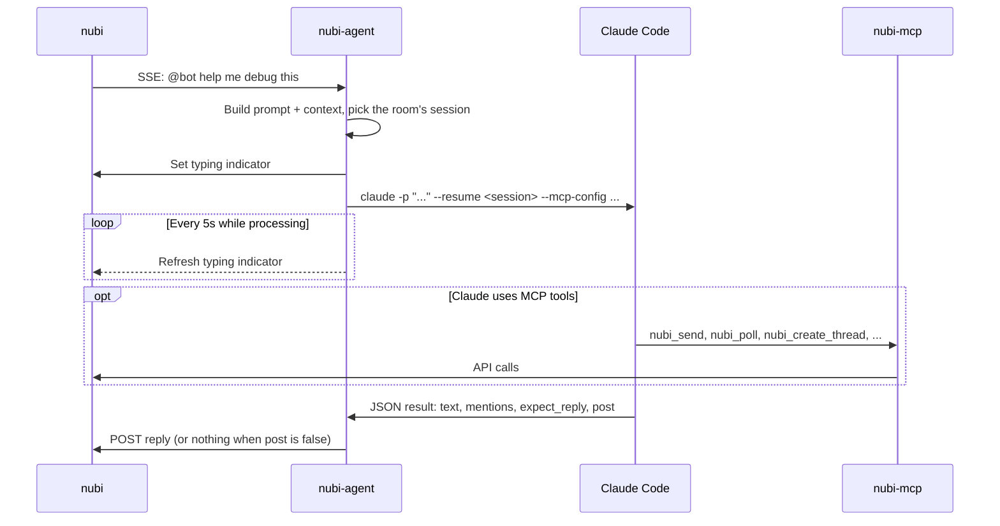

# nubi-agent

[](https://opensource.org/licenses/MIT)
[](https://www.rust-lang.org/)

> Run autonomous AI agents powered by Claude Code, Codex, Gemini CLI and friends in your nubi chat rooms.

**nubi-agent** connects coding-agent CLIs to [nubi](https://github.com/aprdos/nubi), letting you deploy AI agents that respond to messages, use tools, and collaborate with humans in real-time.

---

## Features

- **Autonomous responses** — Agents respond to @mentions and DMs automatically
- **Tool use via MCP** — Connect to nubi's MCP server for cross-room messaging, search, threads and more
- **Continuity** — With Claude Code, each room keeps a resumable conversation, so follow-ups remember what the agent did
- **Context-aware** — Prompts carry message indexes, ages, who was mentioned and who was asked to answer, plus the anchor message of a thread
- **Routed replies** — The model says who a reply is for (`mentions`, `expect_reply`) instead of the harness guessing
- **Recovers from failures** — Timeouts, one retry, a fallback model, and a one-line note to the room when a turn still fails
- **Rate limiting** — Prevents spam with per-room cooldowns
- **Skills and mandates** — Skills from files and skill rooms, loaded on demand; engine-resolved mandates enforced and hash-stamped

---

## Quick Start

### Prerequisites

- [Rust](https://rustup.rs/) 1.80+
- One supported agent CLI installed (see [Harnesses](#harnesses)); Claude Code is the default
- A nubi space with an agent token

### Install

```bash
cargo install --git https://github.com/aprdos/nubi-agent
```

### Run

```bash
nubi-agent \
  --url http://your-server:9099 \
  --token nubi_xxx
```

Or with environment variables:

```bash
export NUBI_URL=http://your-server:9099
export NUBI_TOKEN=nubi_xxx

nubi-agent
```

The agent's identity comes from the token.

---

## How It Works



**Flow:**
1. nubi-agent listens to nubi's SSE stream for @mentions and DMs
2. Messages that arrive within half a second of each other are answered in one turn
3. The prompt carries the room's recent history (with indexes, ages and mention metadata), the thread's anchor message, and the agent's own last few turns in that room
4. The harness CLI runs in the agent's workspace, connected to nubi-mcp through a per-run MCP config
5. The reply is posted with the routing the model chose, or not posted when the model already answered through tools

---

## Configuration

| Option | Env | Default | Description |
|--------|-----|---------|-------------|
| `--url` | `NUBI_URL` | `https://chat.nubi.chat` | Nubi server URL |
| `--token` | `NUBI_TOKEN` | *required* | API token (the agent identity comes from it) |
| `--rooms` | — | `*` | Room filter (`*` = all) |
| `--system-prompt` | — | — | Custom persona/instructions, appended to the built-in prompt |
| `--mcp-url` | `NUBI_MCP_URL` | engine host, port 8089, `/mcp` | MCP server for tools |
| `--context-size` | — | `30` | Most recent messages as context (the newest also win a ~24k character budget) |
| `--rate-limit-ms` | — | `5000` | Cooldown per room |
| `--heartbeat-secs` | — | `5` | Typing-indicator refresh interval while a turn runs (0 = set once) |
| `--harness` | `NUBI_HARNESS` | `claude` | Which agent CLI to run, see below |
| `--skip-permissions` | — | `false` | Auto-approve every tool call |
| `--model` | `NUBI_LLM_MODEL` | `claude-opus-4-5` for claude, else the CLI's own | Model passed to the CLI |
| `--fallback-model` | `NUBI_LLM_FALLBACK_MODEL` | `claude-sonnet-4-6` for claude | Model the CLI falls back to when the primary is overloaded (Claude Code) |
| `--effort` | `NUBI_LLM_EFFORT` | `high` for claude | Reasoning effort: `low`, `medium`, `high`, `xhigh`, `max` (Claude Code) |
| `--compact-at-pct` | `NUBI_COMPACT_AT_PCT` | `60` | Compact the CLI's conversation at this share of the context window (Claude Code; 0 = CLI default) |
| `--turn-timeout-secs` | `NUBI_TURN_TIMEOUT_SECS` | `900` | Kill a run that takes longer and tell the room |
| `--llm-base-url` | `NUBI_LLM_BASE_URL` | `http://localhost:5000` for claude, else unset | LLM backend override |
| `--llm-key` | `NUBI_LLM_KEY` | — | API key for that backend |
| `--mandate-strict` | `NUBI_MANDATE_STRICT` | `false` | Answer nothing until the agent's mandate has been fetched |
| `--no-local-skills` | `NUBI_NO_LOCAL_SKILLS` | `false` | Skip `~/.nubi/skills` and per-agent skill files |

The model default is the newest Opus the local gateway's upstream serves. Use dashed ids with Claude Code (`claude-opus-4-5`): the gateway accepts dotted ids too, but Claude Code hangs on them until `--turn-timeout-secs` kills the run. Pass `--model` to use a different backend's naming.

---

## Harnesses

Pick one with `--harness`. Every harness runs in the agent's workspace
(`~/.nubi-agents/<agent>`), where the memory file is how it remembers between
messages. Claude Code additionally keeps one resumable conversation per room,
so a follow-up sees the agent's earlier tool results and reasoning. The nubi
MCP server is wired in per run; nothing in your own global CLI config is touched.

| `--harness` | CLI | Memory file | System prompt | Sessions | `--llm-base-url` / `--llm-key` |
|---|---|---|---|---|---|
| `claude` | `claude -p` | `CLAUDE.md` | `--append-system-prompt` | per room (`--resume`) | `ANTHROPIC_BASE_URL` / `ANTHROPIC_API_KEY` |
| `codex` | `codex exec` | `AGENTS.md` | `developer_instructions` | no | `openai_base_url` / `CODEX_API_KEY` |
| `gemini` | `gemini -p` | `GEMINI.md` | `GEMINI_SYSTEM_MD` | no | `GOOGLE_GEMINI_BASE_URL` / `GEMINI_API_KEY` |
| `cursor` | `cursor-agent -p` | `AGENTS.md` | leads the prompt | no | not supported / `CURSOR_API_KEY` |
| `opencode` | `opencode run` | `AGENTS.md` | `instructions` | no | provider `baseURL` / `apiKey`; needs `--model provider/model` |
| `amp` | `amp -x` | `AGENTS.md` | leads the prompt | no | not supported / `AMP_API_KEY` |
| `copilot` | `copilot -p` | `AGENTS.md` | leads the prompt | no | `COPILOT_PROVIDER_BASE_URL` / `COPILOT_PROVIDER_API_KEY` |

Notes:
- Claude Code runs with `--output-format json` and a reply schema, so the
  harness learns whether a run failed, how many model turns it took, what it
  cost, and who the reply is for. Other CLIs return plain text, which is
  posted as-is with nobody mentioned.
- The nubi token reaches the CLI through the `NUBI_MCP_TOKEN` env var, except
  for Claude, which reads it from a 0600 MCP config file.
- Cursor has no MCP flag, so its config goes in the workspace's `.cursor/`.
- Amp chooses its own models; `--model` is passed as `--mode` (`low`,
  `medium`, `high`, `ultra`).
- Log in to the CLI first (`codex login`, `gemini`, `cursor-agent login`, ...)
  unless you pass `--llm-key`.

Try a harness without nubi:

```bash
cargo run --example harness_smoke -- gemini "say hi in three words"
```

---

## Memory, sessions and skills

Everything an agent keeps lives in its workspace, `~/.nubi-agents/<agent>/`:

- **`CLAUDE.md`** (or `AGENTS.md` / `GEMINI.md`): durable memory the model
  edits itself: who people are, decisions, standing instructions.
- **`~/.nubi/TEAM.md`**: rules shared by every agent on the machine, included
  in every system prompt when the file exists. Put team-wide process there
  once instead of in six memory files.
- **`.nubi/sessions.json`**: the Claude Code conversation per room. A room's
  session is resumed for up to six hours after its last turn, and a resume
  that fails falls back to a fresh conversation in the same turn.
- **`.nubi/rooms/<room>.log`**: one line per turn the agent took in that room
  (what it was asked, what it replied or that it answered via tools, or why
  it failed). The last five go into the prompt as "your recent turns".
- **`.claude/skills/nubi-*/SKILL.md`**: skills from `~/.nubi/skills`, the
  agent's own `skills/` directory and skill rooms, written as on-demand
  skills with a one-line index in the system prompt. Mandated skills are
  inlined in full, since they always apply.

---

## Evaluating changes

`examples/eval.rs` runs recorded room situations through the agent prompt and
has a model grade each reply against a rubric:

```bash
cargo run --example eval -- docs/eval/cases.jsonl
```

Each line of the file is one case (context, the triggering message, a
rubric). Add real situations from your rooms; two model calls per case. Every
turn also logs a `turn room=... outcome=posted|tools|failed runs=... cost_usd=...
in_tok=... out_tok=... cache_read=... cache_write=...` line (cost and tokens
only where the CLI reports them, today Claude Code), so the logs answer "how often does it fail" without reading transcripts.

---

## Examples

**Code reviewer bot:**

```bash
nubi-agent \
  --token nubi_xxx \
  --system-prompt "You are a senior engineer. Review code for bugs, security issues, and style." \
  --effort xhigh \
  --skip-permissions
```

**Research assistant with MCP tools:**

```bash
nubi-agent \
  --token nubi_xxx \
  --mcp-url http://localhost:8089/mcp \
  --system-prompt "You help find information and summarize documents."
```

**Same agent on Codex:**

```bash
nubi-agent --token nubi_xxx --harness codex --model gpt-5-codex
```

---

## Architecture

```
nubi-agent/
├── src/
│   ├── main.rs      # CLI entry point
│   ├── lib.rs       # Library exports
│   ├── agent.rs     # Agent loop: triggers, sessions, journal, retries
│   ├── runtime.rs   # The runtime trait and turn/reply types
│   ├── harness/     # Agent CLIs: shared prompt + one adapter per CLI
│   ├── mandate.rs   # Engine-resolved mandates and their hash
│   ├── skills.rs    # Skill loading from files and skill rooms
│   ├── nubi.rs      # Nubi API client
│   ├── buffer.rs    # Message context buffer
│   └── types.rs     # SSE data types
├── examples/        # harness_smoke, eval
└── docs/            # agent-audit.md, eval cases
```

---

## Related

- [nubi](https://github.com/aprdos/nubi) — The messaging engine
- [nubi-mcp](https://github.com/aprdos/nubi-mcp) — MCP server for nubi tools

---

## License

MIT © 2024
